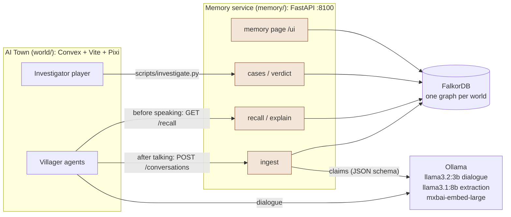
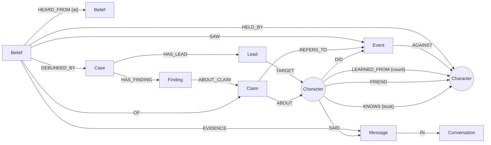

# gossip-graph

**A village whose memory is a FalkorDB graph.** The villagers of Chandanpur chat in a pixel-art town; every rumor they hear becomes a belief in the graph, with a confidence and a trail back to whoever started it. When a theft happens, an investigator agent who knows nothing arrives, uses the graph's structure to decide whom to question, follows the trail interview by interview, survives a crash by handing the case file to a colleague, and publishes a verdict that corrects what the village believes.

**Graph Hacks (WeMakeDevs × FalkorDB) — Track 2: Agent Memory & Coordination.** Built solo by [@yubaraj2000](https://github.com/yubaraj2000).

🎥 **Demo video:** https://youtu.be/PaLzaujH6Yw

---

## The story in one minute

1. **Gossip.** Ramesh the blacksmith sees Kabir, a traveler, steal his silver hammer. He tells Gopal the milkman (who now believes it at 70%), and Gopal, the bridge between the village's two friend circles, carries it to Balwant the constable (35%). Every hop is a `HEARD_FROM` edge; confidence fades with distance and with each listener's personality.
2. **"Why do you think that?"** Ask any villager and the answer comes from a graph path, not from the LLM: *"Gopal told me. Gopal heard it from Ramesh. Ramesh saw it happen."* Made-up rumors trace back to whoever said them first: *"…Pandit Shastri started it, and nobody saw it happen."*
3. **The investigator.** Inspector Vikram starts with a briefing computed from the village's structure alone (PageRank for news hubs, betweenness for bridges, friend circles), interviews the most promising people, and turns every *"X told me"* into a new lead.
4. **Crash and handoff.** Vikram's process dies mid-case. Inspector Anjali starts fresh, reads the case file stored in the graph, and continues from the next lead without repeating an interview. She inherits the file, not Vikram's opinions.
5. **The verdict corrects memory.** True stories are confirmed (*someone saw it*), lies are marked unfounded, honest garblings are marked distorted. Debunked beliefs are kept but superseded, their starters lose trust, villagers remember the correction, and the rumor can't spread again.
6. **Separate villages.** A second Chandanpur, copied from a template with `GRAPH.COPY`, has the same people and none of the history: there, Kabir is a stranger.

## Why the graph is essential

The town is [AI Town](https://github.com/a16z-infra/ai-town) (MIT), but **its own vector memory was deleted**. Before a villager speaks, AI Town asks our memory service what they remember (`GET /recall`, Cypher over FalkorDB); after a conversation, it sends the transcript (`POST /conversations`). Without FalkorDB the villagers remember nothing, and there is no gossip, no provenance, no investigation.

**The graph is the brain, the LLM is the mouth.** A small local LLM does exactly two things: it turns finished conversations into claims, and it phrases what the graph tells a villager to say. It never writes Cypher. Who believes what, how strongly, who told whom, what to talk about, who to interview, and what's true are all decided in the graph.

## Architecture



| Part | What it is |
|---|---|
| `memory/` | The graph-memory service (Python, FastAPI): ingest, recall, explain, narrator events, cases and verdicts, village templates, and the memory page. All of this is our work. |
| `world/` | AI Town, modified: vector memory replaced by the service, the village of Chandanpur, the graph choosing what NPCs talk about, an investigator who can walk and talk in town, a cap on simultaneous conversations, whole-map zoom, a Memory button. Every change is its own commit after the unmodified import, so `git diff 2ddae25 -- world/` shows exactly what we changed (see [`world/UPSTREAM.md`](world/UPSTREAM.md)). |
| `scripts/` | Seeding, the investigator agent, the background village and isolation check, a live feed, the Ollama tunnel, LLM timing, query export. |
| FalkorDB | Docker (`docker-compose.yml`), one graph per world: `world_<id>`, plus `template_<name>` village templates. |
| Ollama | Any reachable Ollama server. We ran it CPU-only on a second machine (i9-13900K) through an SSH tunnel. |

## Data model



- An **`Event`** is what really happened (recorded by a narrator); a **`Claim`** is what someone says; a **`Belief`** is one character's stance on a claim: `confidence` 0–1, `origin` (`witnessed`, `heard`, or `self` = said first), `status` (`active` or `superseded`).
- **`HEARD_FROM`** links a listener's belief to the speaker's belief: following it backwards is the answer to "who told you?". **`EVIDENCE`** points at the exact line they heard.
- **`KNOWS {trust}`** is the social graph; **`FRIEND`** marks the village's lasting friendships; **`LEARNED_FROM`** rolls up who learns from whom.
- **`Case` / `Lead` / `Finding`** are the investigation's shared state: the file a replacement investigator reads.

Full model, rules and confidence math: **[docs/DATA_MODEL.md](docs/DATA_MODEL.md)**.

## How the graph does the work

Every one of the **78 Cypher queries** the service runs is listed, verbatim from the source, in **[docs/QUERIES.md](docs/QUERIES.md)** (generated by `scripts/export_queries.py`). The important ones:

**1. Hearing gossip** (`ingest.HEAR`). The listener's confidence is the speaker's confidence × the listener's trust in the speaker (their `KNOWS` edge, or their personality's `gullibility` for strangers). A second independent source combines as `1 − (1 − old)(1 − new)`. The two `WHERE NOT` lines stop a villager from being reinforced by their own rumor coming back, or by the same source twice.
```cypher
MATCH (lis:Character {id: $listener}), (spk:Character {id: $speaker}), (c:Claim {id: $claim})
MATCH (sb:Belief {holder: $speaker, claim: $claim, status: 'active'})
WHERE NOT (sb)-[:HEARD_FROM*1..8]->(:Belief {holder: $listener})
  AND NOT (:Belief {holder: $listener, claim: $claim})-[:HEARD_FROM]->(sb)
OPTIONAL MATCH (lis)-[k:KNOWS]->(spk)
WITH lis, spk, c, sb, sb.confidence * coalesce(k.trust, lis.gullibility, 0.5) AS incoming
MERGE (b:Belief {holder: $listener, claim: $claim})
ON CREATE SET b.confidence = incoming, b.origin = 'heard', b.status = 'active', b.created_at = $ts
ON MATCH SET b.confidence = 1 - (1 - b.confidence) * (1 - incoming)
MERGE (b)-[:HELD_BY]->(lis)
MERGE (b)-[:OF]->(c)
MERGE (b)-[:HEARD_FROM {at: $ts}]->(sb)
MERGE (lis)-[l:LEARNED_FROM]->(spk)
ON CREATE SET l.count = 1
ON MATCH SET l.count = l.count + 1
WITH b
MATCH (m:Message {id: $msg})
MERGE (b)-[:EVIDENCE]->(m)
RETURN b.confidence, b.origin
```

**2. Recall: what a villager brings up** (`recall.BELIEFS`), replacing AI Town's vector search. Beliefs are ranked by `confidence × |valence| × relevance` (2× if it's about the person they're talking to, 1.5× if about someone that person knows), and damped if the two already exchanged it. The top fresh piece of news becomes the conversation's **topic**: the graph decides what to say, the LLM only says it.

**3. "Who told you?"** (`explain.PATHS`): every provenance path behind a belief, via a variable-length `HEARD_FROM*0..8` match that stops at the first witnessed or made-up belief. The answer sentence is built from the path itself.
```cypher
MATCH (:Character {id: $holder})<-[:HELD_BY]-(b:Belief {status: 'active'})-[:OF]->(c:Claim)-[:ABOUT]->(s:Character)
WHERE ($claim IS NULL OR c.id = $claim) AND ($subject IS NULL OR s.id = $subject)
MATCH p = (b)-[:HEARD_FROM*0..8]->(root:Belief)
WHERE (root.origin <> 'heard' OR NOT (root)-[:HEARD_FROM]->())
  AND all(x IN nodes(p)[0..size(nodes(p)) - 1] WHERE x.origin = 'heard')
OPTIONAL MATCH (root)-[:SAW]->(e:Event)
OPTIONAL MATCH (c)-[:REFERS_TO]->(ev:Event)
RETURN c.id, c.text, s.id, c.valence, b.confidence, b.origin,
       [x IN nodes(p) | x.holder] AS chain, [x IN nodes(p) | x.confidence] AS confidences,
       root.origin, e.description, count(ev) > 0 AS grounded
ORDER BY b.confidence DESC, c.id, length(p)
```

**4. Graph algorithms as gameplay** (`cases.briefing`, also the memory page's Insights tab):
```cypher
CALL algo.betweenness({nodeLabels: ['Character'], relationshipTypes: ['FRIEND']}) YIELD node, score  // bridges
CALL algo.pageRank('Character', 'LEARNED_FROM') YIELD node, score                                    // news hubs
```
Friend circles are the connected groups of `FRIEND` ties once the top bridge is removed (computed in Python: FalkorDB's `algo.labelPropagation` grouped unconnected villagers on this graph, so we don't use it). On Chandanpur, Gopal is the bridge (betweenness 24) between {Ramesh, Sarla, Chotu, Lakshmi} and {Meera, Balwant, Pandit Shastri}.

**5. The vector index** (`db.idx.vector.queryNodes` on `Claim.embedding`, 1024-d `mxbai-embed-large`, cosine):
- **Claim dedup:** a paraphrase about the same subject within distance 0.10 is the same claim ("Kai swiped Bram's hammer" = "Kai stole a silver hammer from Bram"). The subject filter matters: "Tom stole a silver hammer from Bram" is only 0.138 away.
- **Testimony:** a villager only talks to the investigator about claims within 0.40 of the case question, and names only who told them directly, so the trail must be followed one interview at a time.

**6. The verdict rewrites memory without deleting it** (`cases.SUPERSEDE`, `cases.LOWER_TRUST`): debunked beliefs get `status: 'superseded'`, `valid_to` and a `DEBUNKED_BY` edge to the case; for a made-up (unfounded) rumor, each misled villager's trust in its starter is halved, while honest garbling costs nobody trust. Recall then skips superseded beliefs and adds *"I used to believe…, but Inspector Anjali's inquiry found Lakshmi started it"*, and `HEAR` requires an active speaker belief, so the rumor can't spread again.

**7. Separate memory per village** (`templates.start_world`): `GRAPH.COPY template_chandanpur world_<id>` starts a new village in 6–10 ms, indexes included. FalkorDB has no cross-graph queries, so villages can't leak into each other; `scripts/background_village.py` checks it.

## Track 2 coverage

| Track 2 focus | In gossip-graph |
|---|---|
| Episodic memory | `Conversation`, `Message` (every line kept), `Event` (ground truth) |
| Semantic memory | `Claim` + `Belief` with confidence, origin and validity; deduplicated by key and by meaning |
| Persistent conversation history | Recall pulls shared past episodes and beliefs into every new conversation |
| Shared state and handoffs | The case file (`Case`, `Lead`, `Finding`): a replacement investigator resumes after a crash with no repeated work |
| Memory updates and corrections | Verdicts supersede beliefs (never delete), lower trust in rumor-starters, and block re-spreading |
| Multi-agent coordination | Villagers spread information to each other through the graph; two investigators coordinate only through the case file |
| Separate memory per tenant | One graph per world; new worlds start from a `GRAPH.COPY` template; isolation checked |
| Concurrency | AI Town reports each conversation once per participant at the same moment; an atomic status `MERGE` makes exactly one ingest win, and setup is race-safe |

## The memory page

`http://127.0.0.1:8100/ui` (or the **Memory** button in the town) shows the graph behind the town, live:
- **Live feed and map:** every belief as it forms ("👂 Chotu heard it from Gopal… 54%"), flashing the speaker → listener link; the layout follows friendships, so the circles and the bridge are visible.
- **"Why do you think that?":** click a villager, then a belief: the trail lights up with each person's confidence (*Pandit Shastri · 60% → Ramesh · 30% → Gopal · 21%*).
- **Insights:** bridges, news hubs, circles, and what the village believes about each person.
- **Case:** the investigation as it happens: briefing, leads, interviews, verdict, and the investigators' trail on the map.

## Results

- **Rehearsal on a fresh village (Oct 17):** the theft was witnessed at 16:15; by 16:35 five villagers believed it, including Ramesh → Gopal (70%) → Balwant (35%) across the bridge. Vikram interviewed Ramesh and Gopal and crashed; Anjali resumed from the file, interviewed Meera, and confirmed the theft. About 35 minutes end to end.
- **Latency:** recall ~2 ms, one "why" ~6 ms, Insights 10–15 ms, `GRAPH.COPY` 6–10 ms. The LLM is the bottleneck: measuring every call showed a single CPU queue, and tuning threads plus capping simultaneous conversations cut the gap between chat lines from 19 s to 12 s (median).
- **Tests:** 121 Python tests (plus 2 opt-in live-LLM tests) on a real FalkorDB, and 56 AI Town tests.

## Run it yourself

**Needs:** Docker, Node 20+ (we used 24), [uv](https://docs.astral.sh/uv/) (Python 3.12), and an Ollama server with `llama3.2:3b`, `llama3.1:8b` and `mxbai-embed-large` (`ollama pull` each; CPU works, a GPU is faster).

**First time** (one-off configuration):
```bash
git clone https://github.com/yubaraj2000/gossip-graph && cd gossip-graph
uv sync && (cd world && npm install)

cd world && docker compose up -d backend          # self-hosted Convex for AI Town (127.0.0.1:3210)
docker compose exec backend ./generate_admin_key.sh
# create world/.env.local (gitignored) with:
#   CONVEX_SELF_HOSTED_URL=http://127.0.0.1:3210
#   CONVEX_SELF_HOSTED_ADMIN_KEY=<the key printed above>
#   VITE_CONVEX_URL=http://127.0.0.1:3210
#   INVESTIGATOR_SECRET=<any random string>
npx convex env set OLLAMA_HOST http://host.docker.internal:11434      # where Convex reaches Ollama
npx convex env set OLLAMA_MODEL llama3.2:3b   # we used llama3.2:3b-t24 (scripts/ollama-models.sh): 24 CPU threads
npx convex env set OLLAMA_EMBEDDING_MODEL mxbai-embed-large
npx convex env set MEMORY_SERVICE_URL http://host.docker.internal:8100
npx convex env set INVESTIGATOR_SECRET <the same random string>
cd ..
```

**Every time: one command.**
```bash
OLLAMA_URL=http://127.0.0.1:11434 scripts/up.sh   # or set OLLAMA_SSH_HOST and let it tunnel a remote Ollama to :11435
```
`scripts/up.sh` starts FalkorDB, Convex, the memory service, the town page and (on macOS) a keep-awake hold, deploys the town's code, creates and seeds the village if there is none, and checks each part; it only starts what isn't already running. `scripts/up.sh status` checks without starting anything; `scripts/up.sh down` stops what it started. `scripts/reset_village.sh --yes` starts the village over (fresh world, seeded, plus the template and its background copy).

Then open **http://127.0.0.1:5173/ai-town** and press **Memory** for the graph (**http://127.0.0.1:8100/ui**).

Keep the town's tab open (it sends the world's heartbeat). Then play the demo:
```bash
# the theft: only Ramesh sees it
curl -X POST http://127.0.0.1:8100/worlds/<worldId>/events -H 'content-type: application/json' \
  -d '{"kind":"stole_from","actor":"Kabir","target":"Ramesh","witnesses":["Ramesh"],
       "description":"Kabir stole a silver hammer from Ramesh","valence":-1}'
uv run python -m scripts.live_feed                     # watch beliefs form (or the memory page)
uv run python -u -m scripts.investigate "Inspector Vikram" --in-town --crash-after 2
uv run python -u -m scripts.investigate "Inspector Anjali" --in-town --character f3
uv run python -m scripts.background_village --fresh --good-deed   # a second village + isolation check
```

Tests: `uv run pytest` (FalkorDB must be running) and `cd world && npm test`.

## Limitations

- **A small CPU LLM extracts claims imperfectly.** Code-side filters drop most junk (unknown people, neutral chatter, questions, speculation, self-gossip), and the investigator's verdict makes the remaining noise visible instead of hiding it.
- **Speed:** on a CPU-only Ollama, a chat line takes ~12 s and claim extraction ~80 s per conversation; a rumor needs ~20 minutes to reach five villagers.
- **Local setup:** the stack runs on one machine (plus an optional Ollama box); there's no hosted deployment.

## Built with AI (disclosure)

This project was built with an AI coding assistant (**Claude Code**, Anthropic) as a pair programmer: it wrote most of the code and tests under the participant's direction, step by step, with every step reviewed and every commit made by the participant. Ideas, decisions and experiments, including failures, are logged in **[RESEARCH_LOG.md](RESEARCH_LOG.md)**, each tagged **[me]** (the participant) or **[AI]**. A plain-language walkthrough of how it works is in [docs/WALKTHROUGH.md](docs/WALKTHROUGH.md).

The demo video was recorded by driving the browser with a script, and its narration is a macOS text-to-speech voice.

At runtime the villagers speak through **Llama 3.2 3B** and claims are extracted by **Llama 3.1 8B**, both via Ollama; embeddings are **mxbai-embed-large**.

## Credits

- [AI Town](https://github.com/a16z-infra/ai-town) by a16z-infra (MIT), the pixel-art world and NPC engine in `world/`; its license is kept in [`world/LICENSE`](world/LICENSE).
- [FalkorDB](https://www.falkordb.com/), the graph database that holds every memory.
- [vis-network](https://visjs.github.io/vis-network/) for the memory page's map.
- Meta's Llama models and mixedbread's mxbai-embed-large, served by [Ollama](https://ollama.com/).
