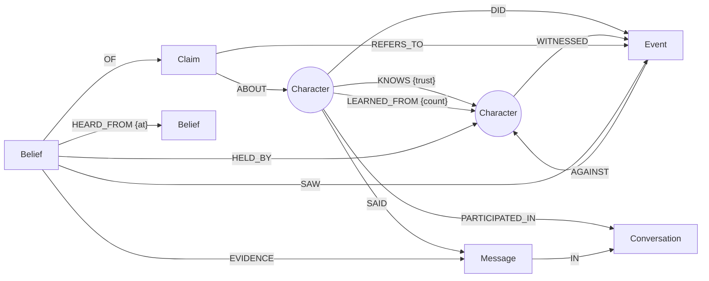

# Graph Data Model — gossip-graph

Every NPC's memory lives in FalkorDB. An NPC knows something only if there is a `Belief` node that links it to a `Claim`. It knows *why* it believes it by following the belief's `HEARD_FROM` chain back to a witness, or to the character who made it up.

> **Status:** current as of Oct 17 (Phases 2–5). The core queries below are copied from the code; **every** query the service runs is in [QUERIES.md](QUERIES.md), generated from the source.

## Decisions (Oct 16)

| Topic | Chosen | Possible later additions |
|---|---|---|
| Claim types | Fixed predicate vocabulary, plus a free-text fallback with vector dedup | — |
| Trust | Fixed confidence rules, plus a per-character `gullibility` trait | Trust that learns from false rumors (Phase 4, optional) |
| Conversation storage | Every message is kept | Condensing old conversations into summaries (Phase 4, optional) |

## Principles

1. **One graph per world.** The graph is named `world_<convexWorldId>`. Worlds are fully isolated (separate memory per tenant), and writes to different worlds run in parallel.
   - **Village templates** (step 4.6): `template_<name>` holds a village's starting state only (characters, gullibility, `KNOWS` trust, `FRIEND` ties) plus the schema and indexes. A new world can start as a copy: `GRAPH.COPY template_chandanpur world_chandanpur_b` (about 6 ms; indexes, including the vector index, are copied). After that the copy is independent: events and gossip in one world never reach another world or the template. Endpoints: `POST /templates/{name}`, `GET /templates`, `POST /worlds/{id}/from-template/{name}` (409 if the world exists), `DELETE /worlds/{id}`.
2. **The graph is the brain, and the LLM is the mouth.** Recall, provenance, reputation and gossip ranking are deterministic Cypher. The LLM only does two things:
   - extracts claims from finished conversations
   - turns recalled context into dialogue

   The LLM never writes Cypher.
3. **Nothing is deleted.** Old beliefs are marked `superseded` with a `valid_to` time, so the history of what an NPC used to believe stays queryable.
4. **Truth and belief are separate.** An `Event` is what really happened, and a `Claim` is what someone says. A claim linked to an event is grounded. A claim with no witness at the root of its chain is an unverified rumor.

## Diagram



## Nodes

| Label | Key properties | Memory type | Created by |
|---|---|---|---|
| `Character` | `id` (AI Town player id, e.g. `p:3`), `name`, `kind` (`npc` or `human`), `identity`, `gullibility` (0–1, personality) | — | world seed, or a human joining |
| `Conversation` | `id` (e.g. `c:29`), `started_at`, `ended_at`, `summary`, `ingested` | **episodic** | ingest |
| `Message` | `id`, `idx`, `text`, `ts` | **episodic** | ingest |
| `Event` | `id`, `kind`, `description`, `ts`, `severity` (0–1) | **episodic** (ground truth) | narrator endpoint |
| `Claim` | `id`, `key` (`subject\|predicate\|object`), `predicate`, `text`, `valence` (−1 to +1), `embedding` (1024-d) | **semantic** (the proposition) | ingest or narrator |
| `Belief` | `holder` (character id), `claim` (claim id), `confidence` (0–1), `origin` (`witnessed`, `heard` or `self`), `status` (`active` or `superseded`), `created_at`, `valid_to` | **semantic** (one character's stance) | ingest or narrator |
| `Case` | `id`, `title`, `question`, `status` (`open` or `solved`), `opened_at`, `briefing` (JSON) | **shared state / handoff**: the case file | `POST /worlds/{id}/cases` |
| `Lead` | `case`, `target`, `kind` (`hub`, `bridge`, `circle`, `source` or `chosen`), `reason`, `priority`, `status` (`open`, `done` or `dropped`) | **shared state**: who to interview, and why | case briefing; later interviews |
| `Finding` | `case`, `claim`, `said_by`, `testimony` (`witnessed`, `heard` or `self`), `sources` (direct source names), `line` | **shared state**: the case notes a replacement reads | each interview |

`Belief.holder` and `Belief.claim` repeat information that the relationships already hold. This makes `MERGE` idempotent and lookups indexed: there is exactly one belief per (holder, claim).

## Relationships

| Type | From → To | Meaning |
|---|---|---|
| `KNOWS {trust, interactions}` | Character → Character | Social graph, directed: A's trust in B. Seeded, then updated after each conversation. |
| `FRIEND` | Character → Character | The village's lasting friendships (seeded only). `KNOWS` also grows with every first conversation and soon links almost everyone, so the briefing reads circles and bridges from `FRIEND`. |
| `INVESTIGATES {since, active}` | Character → Case | Who is (or was) on the case. A replacement makes the previous investigator inactive. |
| `HAS_LEAD` / `TARGET` | Case → Lead → Character | The case's interview list |
| `HAS_FINDING` / `ABOUT_CLAIM` / `FROM_INTERVIEW` | Case → Finding → Claim / Conversation | Case notes: who said what, and how they know it |
| `PART_OF` / `RESOLVED_BY` | Conversation → Case, Lead → Conversation | Interviews belong to the case and close their lead |
| `LEARNED_FROM {count}` | Character → Character | Rolled-up "who learned things from whom". Used for influence ranking. |
| `PARTICIPATED_IN` | Character → Conversation | Who was in the conversation |
| `SAID` / `IN` | Character → Message → Conversation | The transcript |
| `DID` / `AGAINST` / `WITNESSED` | Character → Event → Character | Who did what to whom, and who saw it |
| `ABOUT` | Claim → Character | Who the claim is about |
| `REFERS_TO` | Claim → Event | The claim is grounded in a real event |
| `HELD_BY` / `OF` | Belief → Character / Claim | Who believes what |
| `HEARD_FROM {at}` | Belief → Belief | **Provenance.** The listener's belief came from the speaker's belief. Can have several sources. |
| `SAW` | Belief → Event | A root belief: the holder witnessed the event |
| `EVIDENCE` | Belief → Message | The exact line where the holder heard it |
| `DEBUNKED_BY {kind, started_by, by}` | Belief → Case | A published verdict superseded this belief (`unfounded` or `distorted`); the belief keeps `status: 'superseded'` and `valid_to`, and is never deleted |

## Rules

- **Witnessing:** each witness of an event gets a root belief with `confidence = 1.0`, `origin = 'witnessed'` and a `SAW` edge.
  - Events come from the **narrator**, `POST /worlds/{id}/events` (`memory/narrate.py`). The event's claim uses the same key NPC gossip produces (`actor|kind|target`), so rumors before or after attach to it (by key, or by meaning for paraphrases), and the claim gets `REFERS_TO` the event.
  - A witness who had only *heard* the rumor is upgraded to `witnessed`.
  - Sending the same event again is harmless, because the id is a hash of the event.
- **Hearing:** when A tells B a claim, B's incoming confidence is `confidence(A's belief) × trust(B→A)`. If B has no `KNOWS` edge to A, the trust is **B's `gullibility`**, the personality trait: suspicious Tom has 0.3, gossipy Mara has 0.7. If that isn't set either, the trust is `0.5`.
- **Hearing again from another source:** the beliefs combine as `1 − (1 − old)(1 − incoming)`, and a second `HEARD_FROM` edge is added. More independent sources make a belief more certain.
- **Inventing:** if a speaker asserts a claim it has no belief for, the speaker gets a belief with `origin = 'self'` and confidence 0.6. This is how rumors and lies are born, and `explain` shows that they have no witness.
- **Idempotency:** AI Town calls "remember conversation" **once per NPC participant**. A single query atomically moves `Conversation.status` from `new` (or `failed`) to `ingesting`. Queries on one graph run one at a time, so exactly one caller wins and the other gets `skipped`.
- **Echo guard:** hearing your own rumor back adds nothing. If the speaker's belief is downstream of the listener's (`(sb)-[:HEARD_FROM*1..8]->(listener's belief)`), it's skipped.
- **Repeat guard:** hearing the same claim again from the *same* speaker belief doesn't raise confidence. Only independent sources do.
- **No self-adoption:** a character never adopts a claim about themselves.
- **No self-gossip:** a claim whose subject is the speaker is dropped at extraction. People don't spread rumors about themselves; when the model makes the speaker the subject, it has misread reported speech or chatter, and a verdict would otherwise blame the speaker as the rumor's starter.
- **Acquaintance:** talking creates `KNOWS` edges in both directions. On first contact, trust is the truster's `gullibility`.
- **Failure handling:**
  - The transcript is stored *before* the LLM step, so the episode is never lost.
  - A model failure returns HTTP 502 and leaves status `failed`.
  - Claims are parsed one at a time, so a malformed claim is dropped without losing the others.
  - At service start, leftover `ingesting` conversations (from a crash) are marked `failed`.
  - A retry loop (every `RETRY_INTERVAL_S`, default 60 s, only while Ollama is reachable) rebuilds failed conversations from the stored transcript and ingests them again. `POST /worlds/{id}/retry` does the same on demand.
  - A lock older than 10 minutes can also be retaken by a resend.
- **Validation in code** (the 8b model doesn't reliably follow the prompt):
  - the subject must be a known character, and not the speaker (no self-gossip)
  - the claim text must name the subject
  - neutral claims (|valence| < 0.15) are dropped: they aren't gossip
  - instructions, plans, questions, speculation ("perhaps…", "might…") and lowercase fragments are dropped as "not a statement"
  - for person predicates, a non-person object is replaced by the other person named in the text; if there is none, the predicate becomes `did`
  - valence is clamped to −1…1
- **Claim keys:** person-to-person claims (`stole_from`, `helped`, …) use the structured key `subject|predicate|person`, so "stole" and "swiped" merge. Generic claims (`did`, `is`, `plans_to`, or no person object) use `subject|predicate|<normalized text>`, because a structured key like `p:9|did|` merged *different* stories.
- **Claim dedup:**
  - First an exact `key` match.
  - Then vector similarity on `Claim.embedding`, **only among claims about the same subject**, with distance < **0.10**. FalkorDB's vector `score` is a cosine **distance** (lower means closer).
  - mxbai-embed-large distances from "Kai stole a silver hammer from Bram":

    | Compared text | Distance |
    |---|---|
    | "Kai swiped Bram's silver hammer" (paraphrase) | 0.089 → merged |
    | looser paraphrase | 0.177 |
    | the "fence" rumor mutation | 0.181 |
    | "Tom stole a silver hammer from Bram" (different subject!) | 0.138 |

  - So embeddings alone cannot be trusted: the key comes first, and the vector check is always filtered by subject.

## Core queries (all verified)

**Q1 — Ingest "listener heard claim from speaker"** (`ingest.HEAR`). The two `WHERE NOT` lines are the echo and repeat guards.
```cypher
MATCH (lis:Character {id: $listener}), (spk:Character {id: $speaker}), (c:Claim {id: $claim})
MATCH (sb:Belief {holder: $speaker, claim: $claim, status: 'active'})
WHERE NOT (sb)-[:HEARD_FROM*1..8]->(:Belief {holder: $listener})
  AND NOT (:Belief {holder: $listener, claim: $claim})-[:HEARD_FROM]->(sb)
OPTIONAL MATCH (lis)-[k:KNOWS]->(spk)
WITH lis, spk, c, sb, sb.confidence * coalesce(k.trust, lis.gullibility, 0.5) AS incoming
MERGE (b:Belief {holder: $listener, claim: $claim})
ON CREATE SET b.confidence = incoming, b.origin = 'heard', b.status = 'active', b.created_at = $ts
ON MATCH SET b.confidence = 1 - (1 - b.confidence) * (1 - incoming)
MERGE (b)-[:HELD_BY]->(lis)
MERGE (b)-[:OF]->(c)
MERGE (b)-[:HEARD_FROM {at: $ts}]->(sb)
MERGE (lis)-[l:LEARNED_FROM]->(spk)
ON CREATE SET l.count = 1
ON MATCH SET l.count = l.count + 1
WITH b
MATCH (m:Message {id: $msg})
MERGE (b)-[:EVIDENCE]->(m)
RETURN b.confidence, b.origin
```
Test result: Bram → Pip gave 0.90, Pip → Mara 0.72, Mara → Tom 0.43. A second source, Bram → Tom directly, raised Tom's belief to **0.60**.

**Q2 — Recall: what I bring up when talking to someone.** This replaces AI Town's vector `searchMemories`. Served by `GET /worlds/{id}/recall?me=&other=&k=`.
```cypher
MATCH (me:Character {id: $me})<-[:HELD_BY]-(b:Belief {status: 'active'})-[:OF]->(c:Claim)-[:ABOUT]->(s:Character)
OPTIONAL MATCH (b)-[sh:HEARD_FROM]-(:Belief {holder: $other})
OPTIONAL MATCH (:Character {id: $other})-[kk:KNOWS]->(s)
OPTIONAL MATCH (b)-[:HEARD_FROM]->(:Belief)-[:HELD_BY]->(t:Character)
WITH b, c, s, count(DISTINCT sh) > 0 AS already_shared, count(DISTINCT kk) > 0 AS other_knows,
     collect(DISTINCT t.name) AS told_by
WITH b, c, s, told_by, already_shared,
     CASE WHEN s.id = $other THEN 2.0 WHEN other_knows THEN 1.5 ELSE 1.0 END AS relevance
RETURN c.id, s.id, s.name, c.text, c.valence, b.confidence, b.origin, told_by, already_shared,
       b.confidence * abs(c.valence) * relevance * CASE WHEN already_shared THEN $damping ELSE 1.0 END AS score
ORDER BY score DESC, b.confidence DESC
LIMIT $k
```
- **Ranking:** `confidence × |valence| × relevance`. Relevance is 2 if the claim is about the person I'm talking to, 1.5 if it's about someone they know, and 1 otherwise. A claim we **already exchanged** (either direction of `HEARD_FROM`) is damped ×0.2, so NPCs don't repeat themselves.
- The endpoint also returns:
  - Q5 reputation
  - my `KNOWS` trust
  - Q3 recent episodes
  - ready-to-use **first-person memory lines** for the NPC prompt. They use words instead of numbers ("I believe it", "it's only a rumor to me"), and my own name becomes "me" / "my".
- ⚠️ **Keep every `OPTIONAL MATCH` before the aggregating `WITH`.** On FalkorDB 6.0.2, `OPTIONAL MATCH … WITH <aggregation> OPTIONAL MATCH (b)-…` silently matched nothing.

**Q3 — Shared episodes:** past conversations between the two characters.
```cypher
MATCH (:Character {id: $me})-[:PARTICIPATED_IN]->(cv:Conversation {status: 'ingested'})<-[:PARTICIPATED_IN]-(:Character {id: $other})
RETURN cv.id, cv.summary, cv.ended_at
ORDER BY cv.ended_at DESC
LIMIT $n
```

**Q4 — Explain: "who told you that?"** Returns every provenance path. Served by `GET /worlds/{id}/explain?holder=&claim=&subject=`. It adds the line heard at each hop (the listener's `EVIDENCE` message, said by the next person in the chain), plus an answer sentence built **from the path, not by the LLM**, e.g. *"Mara told me. Mara heard it from Pip, who heard it from Bram. Bram saw it happen."* The verdict is `witnessed` if any path's root `SAW` an event; otherwise `unverified`.
```cypher
MATCH (:Character {id: $holder})<-[:HELD_BY]-(b:Belief {status: 'active'})-[:OF]->(c:Claim)-[:ABOUT]->(s:Character)
WHERE ($claim IS NULL OR c.id = $claim) AND ($subject IS NULL OR s.id = $subject)
MATCH p = (b)-[:HEARD_FROM*0..8]->(root:Belief)
WHERE (root.origin <> 'heard' OR NOT (root)-[:HEARD_FROM]->())
  AND all(x IN nodes(p)[0..size(nodes(p)) - 1] WHERE x.origin = 'heard')
OPTIONAL MATCH (root)-[:SAW]->(e:Event)
OPTIONAL MATCH (c)-[:REFERS_TO]->(ev:Event)
RETURN c.id, c.text, s.id, c.valence, b.confidence, b.origin,
       [x IN nodes(p) | x.holder] AS chain, [x IN nodes(p) | x.confidence] AS confidences,
       root.origin, e.description, count(ev) > 0 AS grounded
ORDER BY b.confidence DESC, c.id, length(p)
```
A path stops at the first belief that was witnessed or said first: a later `HEARD_FROM` from such a belief is corroboration, not where it came from.

Test results:
- Tom's belief came back with two paths: `Tom ← Bram` and `Tom ← Mara ← Pip ← Bram`. Both trace to Bram's witnessed event.
- The rumor "Tom is a smuggler" came back as `Mara ← Pip` with origin `self`: Pip made it up.

**Q5 — Reputation:** how one character sees another (`recall.REPUTATION`). The memory page's village-wide reputation averages this per villager instead of summing it, so being talked about a lot doesn't by itself make someone look worse (`view.REPUTATION`).
```cypher
MATCH (:Character {id: $me})<-[:HELD_BY]-(b:Belief {status: 'active'})-[:OF]->(c:Claim)-[:ABOUT]->(:Character {id: $other})
RETURN coalesce(sum(b.confidence * c.valence), 0.0), count(b)
```

**Q6 — Graph algorithms as gameplay** (the investigator's briefing and the Insights tab, `cases.briefing`)
```cypher
// Bridges: whose silence stops a rumor crossing groups. Read from the seeded FRIEND ties (KNOWS before any exist),
// because KNOWS grows with every first conversation and soon links almost everyone.
CALL algo.betweenness({nodeLabels: ['Character'], relationshipTypes: ['FRIEND']}) YIELD node, score
RETURN node.id, score
// News hubs: who others learn from. LEARNED_FROM points listener -> speaker, so PageRank flows to the sources.
CALL algo.pageRank('Character', 'LEARNED_FROM') YIELD node, score RETURN node.id, score
```
- **Circles** are the connected groups of `FRIEND` ties once the top bridge is removed (`cases._components`, in Python). FalkorDB's `algo.labelPropagation` grouped unconnected villagers together on this graph, so it isn't used.
- On Chandanpur: Gopal is the top bridge (betweenness 24), then Lakshmi (13); the circles are {Ramesh, Sarla, Chotu, Lakshmi} and {Meera, Balwant, Pandit Shastri}.

## Indexes

```cypher
CREATE INDEX FOR (n:Character) ON (n.id)
CREATE INDEX FOR (n:Conversation) ON (n.id)
CREATE INDEX FOR (n:Message) ON (n.id)
CREATE INDEX FOR (n:Event) ON (n.id)
CREATE INDEX FOR (n:Claim) ON (n.id)
CREATE INDEX FOR (n:Claim) ON (n.key)
CREATE INDEX FOR (n:Belief) ON (n.holder)
CREATE INDEX FOR (n:Belief) ON (n.claim)
CREATE VECTOR INDEX FOR (c:Claim) ON (c.embedding) OPTIONS {dimension:1024, similarityFunction:'cosine'}
```

## LLM extraction contract (step 2.3)

There is one call per finished conversation, using `llama3.1:8b` with Ollama's JSON-schema output. It returns:
```json
{
  "summary": "Pip told Mara that Kai stole Bram's hammer.",
  "claims": [
    {"message_index": 0, "subject": "Kai", "predicate": "stole_from",
     "object": "Bram", "text": "Kai stole a hammer from Bram", "valence": -0.8}
  ]
}
```
- **`predicate` vocabulary:** `stole_from`, `attacked`, `helped`, `lied_to`, `gave_to`, `owes`, `likes`, `dislikes`, `is` (a trait), `did` (any other action), `plans_to`.
- **Validation:** see "Validation in code" above. The speaker is taken from `message_index`, never from the model.

## Track 2 coverage

| Track 2 focus | Where it lives in the graph |
|---|---|
| Episodic memory | `Conversation`, `Message`, `Event` |
| Semantic memory | `Claim` plus `Belief` (confidence, origin, validity) |
| Persistent conversation history | `Conversation`/`Message`, recalled with Q3 |
| Shared state and handoffs | The case file (`Case`, `Lead`, `Finding`): a replacement investigator resumes from it after a crash, without repeating an interview; gossip itself flows along `HEARD_FROM` |
| Memory updates and corrections | A verdict marks debunked beliefs `superseded` with `valid_to` and `DEBUNKED_BY` (never deleted); villagers remember the correction and the rumor can't spread again |
| High-concurrency reads and writes | Writes to different world graphs run in parallel; idempotent `MERGE` ingest |
| Separate memory per user/tenant | One graph per world (`world_<id>`); background villages start as a `GRAPH.COPY` of a village template (`template_<name>`) and are checked to stay isolated (`scripts/background_village.py`) |

## FalkorDB gotchas found while validating

- Pattern predicates such as `(a)-[:R]->(b)` work in `WHERE`, but **not** inside `CASE` or `RETURN` expressions. Use `OPTIONAL MATCH` plus `count(x) > 0` instead.
- Vector `score` is a distance. Sort ascending.
- An `OPTIONAL MATCH` after `OPTIONAL MATCH … WITH <aggregation>` silently matched nothing (6.0.2): keep every `OPTIONAL MATCH` before the aggregating `WITH`.
- No `COUNT { }` subqueries; use `OPTIONAL MATCH` plus `count()`.
- `''` quote escaping inside string literals fails; always pass text as a parameter.
- Creating an index that already exists raises "already indexed"; `CALL db.indexes()` on a graph that was never written fails with "empty key".
